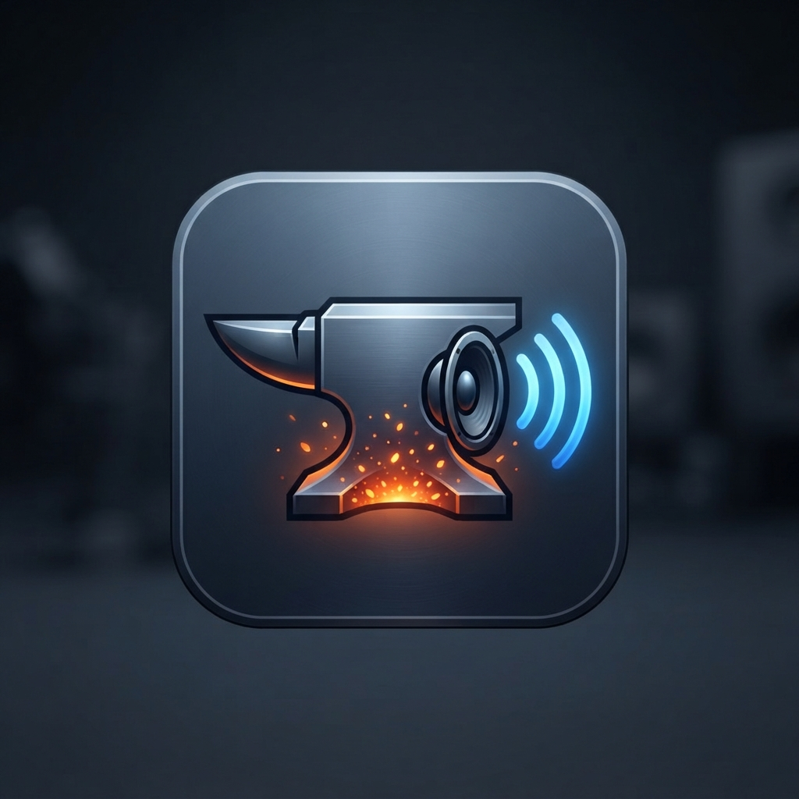

# SpeakerForge



A standalone .NET audio engine for discovering and streaming to network speakers — UPnP/DLNA, Google Cast, and AirPlay — with no UI and no dependencies on any audio engine. Any application can reference this library and control network audio with a few lines of code.

[](LICENSE)

## Features

- **Multi-protocol discovery** — finds UPnP/DLNA renderers (Sonos, TVs, smart speakers), Google Cast devices, and AirPlay/RAOP endpoints on the local network in one pass
- **Unified renderer abstraction** — `INetworkRenderer` hides protocol differences; callers never need to know whether a device speaks SOAP, Cast protobufs, or RTSP/RTP
- **PCM broadcast server** — built-in HTTP-like TCP server that serves a live PCM WAV stream to renderer clients, with per-client buffering so slow devices never stall the source
- **Stereo pairing and channel routing** — assign devices Stereo, Left, Right, or Group roles; the stream URL carries role/gain parameters so one broadcast feeds a multi-room or stereo-pair setup
- **Device control** — play/pause/stop URIs, set volume, query transport state per device
- **Zero external dependencies** — pure .NET, hand-written protocol implementations (no GPL-licensed libraries)

## Supported protocols

| Protocol | Status | Notes |
|---|---|---|
| UPnP/DLNA (AVTransport + RenderingControl) | Verified | Tested against Sonos/Symfonisk devices on real hardware |
| Google Cast v2 | Implemented, hardware-unverified | Hand-written mDNS discovery, TLS, protobuf framing, virtual connection, heartbeat, media control. No Cast hardware was available for end-to-end testing |
| AirPlay 1 / RAOP | Implemented, hardware-unverified | mDNS discovery, RTSP ANNOUNCE/SETUP/RECORD, RTP/L16 streaming. AirPlay 2 pairing/encryption is **not** implemented |

### Tested devices

Help us grow this list — test your speakers and [open a device report](https://github.com/stephenwhite688/Speaker-Forge/issues/new?template=device_test.yml).

| Device | Protocol | Status |
|---|---|---|
| Sonos / Symfonisk | UPnP/DLNA | ✅ Verified — discovery, streaming, volume |
| Samsung HW-S60T soundbar | — | ❌ Confirmed unsupported — no open streaming protocol (Bluetooth/Spotify Connect/HDMI-ARC only) |
| Chromecast / Nest | Cast | ⚠️ Implemented, awaiting hardware test |
| AirPlay devices | AirPlay 1 | ⚠️ Implemented, awaiting hardware test |
| *your device here* | | |

### Devices that cannot be supported

Some speakers expose Wi-Fi only for proprietary ecosystems and have no open streaming interface. Samsung soundbars such as the HW-S60T, for example, accept audio only via Bluetooth, HDMI-ARC, Spotify Connect, or Samsung's proprietary SoundShare (TV-to-soundbar). These devices cannot receive arbitrary PCM streams over the network, and no implementation of this library can change that — it is a hardware/protocol limitation, not missing code.

## Requirements

- .NET 10 (or any .NET version supporting the target framework)
- Windows, macOS, or Linux — all networking is plain TCP/UDP/HTTP; no platform APIs
- Devices and host on the same LAN; UDP multicast (SSDP/mDNS) must not be blocked

## Quick start

```csharp
using SpeakerForge;

// 1. Discover renderers on the network
var service = new NetworkSpeakerService();
service.Start();                       // opens the PCM broadcast server
var devices = await service.DiscoverAsync();
foreach (var d in devices)
    Console.WriteLine($"{d.FriendlyName}  [{d.Protocol}]  {d.Address}");

// 2. Play a stream URI to one device
var speaker = devices.First(d => d.FriendlyName.Contains("Sonos"));
await service.PlayToDeviceAsync(speaker.Id);

// 3. Or feed live PCM to a selected group
await service.PlayGroupAsync(groupId);
```

### Streaming your own PCM

The library can also act as a *source*: push interleaved float PCM into the broadcast server and point renderers at the generated URL.

```csharp
service.Start();
string url = service.Server.BuildStreamUrl("stereo", gain: 1.0);
// url looks like: http://192.168.1.50:8977/stream?role=stereo&gain=1.0

// In your audio callback / render loop:
service.Server.Broadcast(interleavedFloatPcm, frames);
```

`Broadcast` takes **interleaved float PCM** (L,R,L,R…) at a fixed sample rate/channels negotiated by the client URL parameters. Per-client queues decouple producers from consumers, so a slow speaker drops or buffers independently without blocking the realtime source.

### Grouping and stereo pairing

```csharp
var pair = service.CreateStereoPair("Kitchen", leftUdn, rightUdn);
await service.PlayGroupAsync(pair.Id);
```

`SpeakerAssignment` values: `Stereo`, `Left`, `Right`, `Group`. The assignment is encoded into each client's stream URL so left/right speakers receive the correct channel mix.

## Samples

A ready-to-run console sample lives in [`samples/SpeakerForge.Samples.Player`](samples/SpeakerForge.Samples.Player):

```bash
dotnet run --project samples/SpeakerForge.Samples.Player -- discover
# lists every UPnP/DLNA, Cast, and AirPlay speaker on your network

dotnet run --project samples/SpeakerForge.Samples.Player -- tone "Kitchen" 15
# streams a 440Hz test tone to the speaker whose name contains "Kitchen"
```

It demonstrates the whole pipeline in ~100 lines: service startup, discovery, `PlayToDeviceAsync`, and pushing PCM through `Server.Broadcast`.

## API overview

### `NetworkSpeakerService` — main entry point

| Member | Purpose |
|---|---|
| `Start()` / `Stop()` | Start/stop the embedded PCM broadcast server |
| `Server` | `NetworkAudioServer` — `Broadcast(pcm, frames)`, `BuildStreamUrl(role, gain)` |
| `DiscoverAsync(timeoutMs, ct)` | Scan SSDP + mDNS; returns all `INetworkRenderer` devices |
| `AddDeviceByAddressAsync(host, ct)` | Add a device manually by IP/hostname |
| `RemoveDevice(udn)` | Forget a discovered device |
| `Devices` / `Groups` | Current device/group registries |
| `CreateGroup(name)` / `DeleteGroup(id)` / `GetGroup(id)` | Group management |
| `CreateStereoPair(name, leftUdn, rightUdn)` | Convenience stereo pair |
| `AddMember` / `RemoveMember` | Group membership with `SpeakerAssignment` |
| `PlayToDeviceAsync(udn, assignment, uri, ct)` | Play a URI (or the broadcast stream) to one device |
| `PlayGroupAsync(groupId, ct)` | Play to all members of a group |
| `StopDeviceAsync` / `StopGroupAsync` / `StopAllAsync` | Transport control |
| `GetDeviceStateAsync(udn, ct)` | Query playback state |
| `SetDeviceVolumeAsync(udn, volume, ct)` | 0–100 device volume |

### `INetworkRenderer` — protocol-agnostic device

```csharp
public interface INetworkRenderer
{
    string Id { get; }                 // stable device ID (UDN or equivalent)
    string FriendlyName { get; }
    string Manufacturer { get; }
    string ModelName { get; }
    string Address { get; }
    string Protocol { get; }           // "UPnP", "Cast", "AirPlay"
    Task PlayUriAsync(string uri, string metadata = "", CancellationToken ct = default);
    Task StopAsync(CancellationToken ct = default);
    Task SetVolumeAsync(int volume, CancellationToken ct = default);
    Task<string?> GetStateAsync(CancellationToken ct = default);
}
```

### Lower-level types (for advanced use)

- `SsdpDiscovery` / `UpnpDevice` / `UpnpControlClient` — UPnP/DLNA stack
- `CastDiscovery` / `CastClient` / `CastDevice` — Google Cast stack
- `AirPlayDiscovery` / `RaopClient` / `AirPlayDevice` — AirPlay 1/RAOP stack
- `DnsWire` — shared DNS/mDNS packet parsing used by Cast and AirPlay discovery

These are public so hosts can use a single protocol directly if needed, but most applications should stay on `NetworkSpeakerService`.

## Architecture

```
┌─────────────────────┐         ┌──────────────────────────┐
│   Your application  │         │   SpeakerForge │
│                     │         │                            │
│  PCM source ────────┼──► Broadcast() ──► NetworkAudioServer │
│  (any audio engine) │         │       /stream (WAV, PCM16)  │
│                     │         │              │             │
│  DiscoverAsync() ◄──┼─────────┼── SsdpDiscovery           │
│  PlayToDeviceAsync  │         │    CastDiscovery           │
│                     │         │    AirPlayDiscovery        │
│                     │         │              │             │
│                     │         │   INetworkRenderer ────────┼──► UPnP SOAP / Cast TLS+protobuf / AirPlay RTSP+RTP
└─────────────────────┘         └──────────────────────────┘
```

The library deliberately knows nothing about audio engines. To connect a DSP engine (e.g. a sound engine producing processed PCM), adapt its output to `NetworkAudioServer.Broadcast()` — typically with a small host-side node that receives processed interleaved float PCM and forwards it. The two libraries never reference each other; the host application owns that link.

## Known limitations

- **AirPlay 2** (pairing, encryption, multiroom) is not implemented — AirPlay 1/RAOP only
- **Proprietary ecosystems** — HEOS, Play-Fi, BluOS, RAAT, Spotify Connect, Samsung SoundShare are not supported; they are undocumented or cloud-locked
- **Per-device buffering** — `NetworkAudioServer` uses per-client queues; extremely slow clients may experience dropouts rather than back-pressure on the source
- **UPnP queueing** — the DLNA path plays a single live stream URI; native device-side queue/gapless features are not used
- **Cast/AirPlay unverified on hardware** — code paths compile and follow the protocol specs but have not been validated against physical devices

## License

MIT — see [LICENSE](LICENSE). Use it in personal, commercial, or open-source projects; attribution required.

## Project layout

```
SpeakerForge.slnx
└── src/
    └── SpeakerForge/
        ├── NetworkSpeakerService.cs   # main facade
        ├── NetworkAudioServer.cs      # PCM broadcast server
        ├── INetworkRenderer.cs        # device abstraction
        ├── Upnp*.cs, SsdpDiscovery.cs # UPnP/DLNA stack
        ├── Cast*.cs                   # Google Cast stack
        ├── AirPlay*.cs, RaopClient.cs # AirPlay stack
        └── DnsWire.cs                 # shared mDNS/DNS parsing
```
